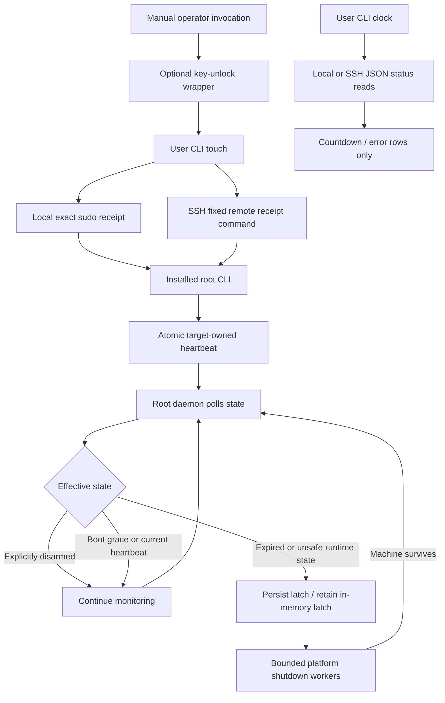

# Architecture and persisted state

## Source layout

| File | Responsibility |
|---|---|
| `src/main.rs` | Clap CLI, target storage, bounded local/SSH helpers, countdown rendering, privileged installation |
| `src/lib.rs` | Policy/state evaluation, platform clocks, durable writes/locks, receipt/arm/disarm APIs, daemon and shutdown workers |
| `heartbeat.sh` | One-key-unlock manual sender wrapper |
| `systemd/grim-reaper.service` | Linux root daemon supervision and filesystem restrictions |
| `launchd/local.grim-reaper.plist` | macOS root LaunchDaemon supervision and root-private logs |
| `Cargo.toml` / `Cargo.lock` | Rust package/release profile and locked dependency resolution |

There is no daemon HTTP server, custom SSH protocol, automatic receipt scheduler, or sender background process. The operator invokes a user CLI; privilege crosses only the existing local sudo or SSH-plus-sudo boundary.

## Control flow

The read-only query path is intentionally separate from receipt delivery. Successful status requests never refresh deadlines. The daemon reads atomic files independently of the sender process and remains supervised after the sender exits.

## Persisted state

Production state is root-private: `/var/lib/grim-reaper` on Linux or `/var/db/grim-reaper` on macOS. macOS `/private/var/db/grim-reaper` is recognized as the same production path for privilege enforcement.

| State object | Contents / invariant |
|---|---|
| `config.json` | JSON `armed`, `timeout_secs`, `boot_grace_secs`; unknown fields and invalid timings are rejected |
| `heartbeat.json` | JSON `wall_secs`, `boot_id`, `uptime_secs`, generated on the target at receipt time |
| `shutdown-latched` | Presence prevents late receipts/rearming; payload also records Linux first-attempt progress |
| `.state.lock` | Private owned regular file used by bounded `flock` mutation serialization |

These are implementation-owned files, not sender configuration. Do not manually delete or rewrite a latch to recover. `disarm` persists disabled policy before clearing the latch. Installed services use fixed state paths; a user target list contains no privileged state-directory override.

Linux latch payload starts as `latched\n` and becomes `reiuso-scheduled\n` before submitting REIUSO. macOS uses the initial latch without Linux sequence scheduling. Any object at the latch path is treated as latched; unknown/unreadable Linux progress cannot safely schedule another first sequence, so enforcement continues through other methods. These payloads are internal state, not a public file-editing API.

General atomic writes create an exclusive mode-0600 temporary in the destination directory, write the entire file, fsync it, rename it atomically, and fsync the parent. The public writer does not itself enforce state-directory ownership; state APIs enforce that policy before using it. Installed executable/service files use corresponding atomic replacement with their required modes.

Receipts, arming, disarming, initialization, and latch scheduling share a mutation lock. CLI acquisition is bounded to three seconds; shutdown transition/scheduling acquisition is bounded to 250 ms. Daemon reads rely on atomic replacement. Before latching a normal expiry, it rechecks policy/receipt under the writers' lock to respect a receipt/disarm that completed before that transition. If locking or persistence fails while enforcement is required, the daemon does not exit or wait indefinitely before attempting shutdown.

## State and clock evaluation

`Config::default()` is disarmed for explicit initialization. Missing, corrupt, unreadable, or invalid persisted configuration is instead evaluated as **armed with default timings**. Those are deliberately different operations: starting a live daemon on an uninitialized directory is unsafe.

For readable state:

1. An explicit valid disarmed configuration suppresses expiry and takes precedence over a latch.
2. Otherwise, an unavailable clock makes an armed state expired because safe age/grace cannot be established.
3. With a valid clock, remaining boot grace is evaluated before normal expiry/latch enforcement.
4. After grace, a latch, invalid/missing receipt, or age at/above timeout makes the state expired.
5. Only an unlatched valid receipt younger than timeout is healthy.

Unsafe directory/snapshot errors become fail-closed runtime status inside the daemon. Administrative `status` can instead report an error; fleet `clock` preserves that as an error row rather than inventing healthy status.

Linux uses its kernel boot UUID and `/proc/uptime`. macOS uses `kern.bootsessionuuid` and `mach_continuous_time`, converted with a cached Mach timebase and checked integer arithmetic. Both uptime paths count suspend/sleep. Same-boot age ignores wall-clock jumps. Across boots, age uses persisted wall seconds and rejects future timestamps. The daemon cannot execute during sleep; expiry is handled on wake. Cross-boot correctness still depends on trustworthy wall time.

The healthy daemon polls roughly once per second. Timed-out shutdown attempts can add worker deadlines during an expiry cycle. This is not a real-time scheduler or hardware watchdog.

## Shutdown supervision

Each method runs in a fork worker in its own process group. Child code uses raw libc operations, static executable/argument strings, and `_exit`; it does not allocate through Rust, invoke Objective-C/Foundation, unwind, or use inherited Rust locks. Helper stdin is `/dev/null`; error reports use a nonblocking pipe. Darwin uses `pipe` plus `fcntl`; Linux uses `pipe2`.

The parent polls with `waitpid(WNOHANG)`, advances on return/failure, and after three seconds sends group/direct SIGKILL without blocking on reap. One tracked unreaped slot per method prevents unlimited copies of an uninterruptible worker. Disarming is checked between methods and during waits. Already-issued kernel actions cannot be undone.

Linux first durably schedules one `_reiuso` write. REIUSO can kill the supervisor itself; systemd PID 1 can restart it with the persisted latch/progress. Survivors continue in order through direct kernel POWER_OFF, forced systemctl poweroff, forced `/sbin/poweroff`, then HALT. Remaining methods repeat with roughly a one-second delay between cycles. If scheduling persistence is unsafe, the first sequence is skipped rather than blocking the other enforcement paths.

macOS attempts cache-flushing quick halt, `/sbin/halt -q`, no-sync quick halt, `/sbin/halt -q -n`, and `/sbin/shutdown -h now`, in order. All remain repeatable while the machine runs. Neither platform uses reboot/panic as a substitute for shutdown.

## Service installation and upgrades

Installation is a privileged explicit command, not a daemon startup side effect. It checks existing policy before replacing code, initializes fresh state disarmed before service start, validates delegation/service files, installs root-owned files atomically, checks service-manager operations, and verifies an active/running service. Linux retires the old Python service/executable. macOS uses a root LaunchDaemon with KeepAlive and a mode-0600 log.

Existing armed, unsafe, or missing-preexisting configuration cannot be silently reset by reinstalling. Upgrade by explicitly disarming, installing, verifying, authenticating administration before the fresh activation receipt, then rearming. There is a deliberate brief maintenance window; hot replacement without disabling enforcement is not promised.

## Relevant upstream interfaces

- [Linux 6.12 SysRq documentation](https://docs.kernel.org/6.12/admin-guide/sysrq.html): underscore-prefixed multi-command writes and individual command semantics. The preferred sequence requires kernel support for this interface; remaining shutdown methods provide fallback.
- macOS SDK `sys/reboot.h` and `mach/mach_time.h`: halt/no-sync/quick flags and sleep-inclusive continuous time.
- macOS `halt(8)` / `reboot(8)`: `-q` quick halt and `-n` no-sync behavior.

These interfaces are not evidence that a particular machine's firmware successfully powers off; see the [verification boundary](verification.md). Keep deployment records outside the public repository.
